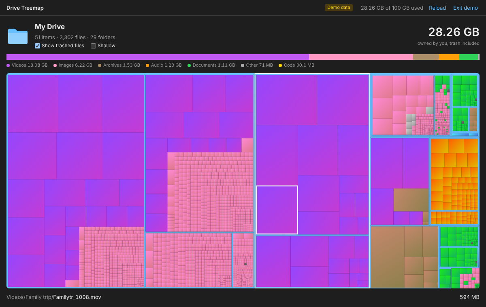

# Drive Treemap

See what fills your Google Drive, as a treemap: every file you own, each rectangle as large as the
space it takes from your storage quota. It is a single static page with no backend: the browser signs
in with Google and reads the Drive API directly.

The view is a web port of the folder treemap in [quicker-look](https://github.com/caesarsol/quicker-look-app)
(`TreemapPreview/`): same squarified layout, same colours and categories, same interactions where the
web allows them.



## Features

- **Squarified treemap** of My Drive, folders outlined in azure, files coloured by category
  (images, videos, audio, archives, code, documents, other) with the same cushion gradient as quicker-look.
- **Small files merged**: items too small to see become one grey tile that keeps their area
  ("1,204 small files · ~12 KB each").
- **Category bar** with legend; hovering a category outlines all its files in the treemap.
- **Status line** with the hovered item's path and size.
- **Show trashed files**: trash counts against the quota, so it is included by default. Toggling it
  switches instantly between two prebuilt trees (quicker-look's "Show hidden files").
- **Shallow**: draws the current folder's children as single blocks.
- **Zoom**: click anywhere inside a folder to enter it, one level per click (the folder a click would
  enter is outlined while hovering); the breadcrumb, `Esc` or `Backspace` go back up. Click a file that
  sits right in the current folder to open it in Drive (quicker-look's "Show in Finder").
- **Progressive loading**: the treemap fills in while Drive is listed, 1,000 items per request.
- **Elsewhere**: files you own that sit in someone else's folder (or in no folder) still use your quota;
  they are gathered under a virtual folder so the total adds up.
- **Demo data** (`?demo`) to try it without signing in.

## Google Cloud setup

Signing in needs an OAuth client ID of your own (free, a few minutes):

1. In [Google Cloud Console](https://console.cloud.google.com/), create or pick a project.
2. **APIs & Services → Library**: enable the **Google Drive API**.
3. **APIs & Services → OAuth consent screen** (Google Auth Platform): set it up as *External* (or
   *Internal* for a Workspace organisation), add the scope
   `https://www.googleapis.com/auth/drive.metadata.readonly`, and while in *Testing* add your account
   as a test user.
4. **Credentials → Create credentials → OAuth client ID → Web application**. Under **Authorized
   JavaScript origins** add every origin you serve the page from, e.g. `http://localhost:8080` and
   `https://<you>.github.io`. No redirect URI is needed.
5. Paste the client ID on the start page (it is remembered in the browser), or set it in `config.js`
   for a deployment, or pass it as `?client_id=…`.

The client ID is not a secret. The app asks for `drive.metadata.readonly` only: names, sizes and
folders, never file contents. The access token lives in the page's memory and is revoked on sign out.

## Run locally

```sh
npm start            # http://localhost:8080/
```

Any static file server works: there is no build step (plain ES modules).

## Tests

```sh
npm install
npm test             # unit tests: layout, tree building, categories, formatting (node:test)
npm run test:e2e     # Playwright: a demo walkthrough, and the Google path with GIS and the API mocked
```

## How it works

| File | Role |
| --- | --- |
| `src/drive.js` | Google Identity Services token client; `about`, `files/root` and paged `files.list` (`'me' in owners`, trash included). |
| `src/tree.js` | Flat file list → tree (sizes from `quotaBytesUsed`), trash filtering, the virtual *Elsewhere* folder. |
| `src/treemap.js` | Squarified layout (Bruls, Huizing, van Wijk), small-files merging, hit testing: a port of `Treemap.swift`. |
| `src/kinds.js` | Categories from MIME type then extension, colours, cushion gradients. |
| `src/app.js` | The view: header, category bar, canvas drawing, hover, zoom, status line. |
| `src/demo.js` | A deterministic fake drive. |

### Differences from quicker-look

- Sizes are quota bytes, not allocated disk blocks. Google Docs, Sheets and Slides use no quota and are
  not drawn.
- "Show hidden files" became "Show trashed files": Drive has no hidden files, but its trash takes space.
- A click inside a folder enters it instead of revealing it, since Drives are much larger than the
  folders Quick Look previews; files of the current folder open in Drive.
- Icons come from Drive's `iconLink`; there are no content thumbnails (they would need extra requests).

### Limits

- Only *My Drive* items you own are listed: shared drives and files shared with you do not use your
  quota. The quota in the top bar is account-wide (it includes Gmail and Google Photos).
- Very large drives take a while to list (about one request per 1,000 items) and the token lasts an
  hour.
